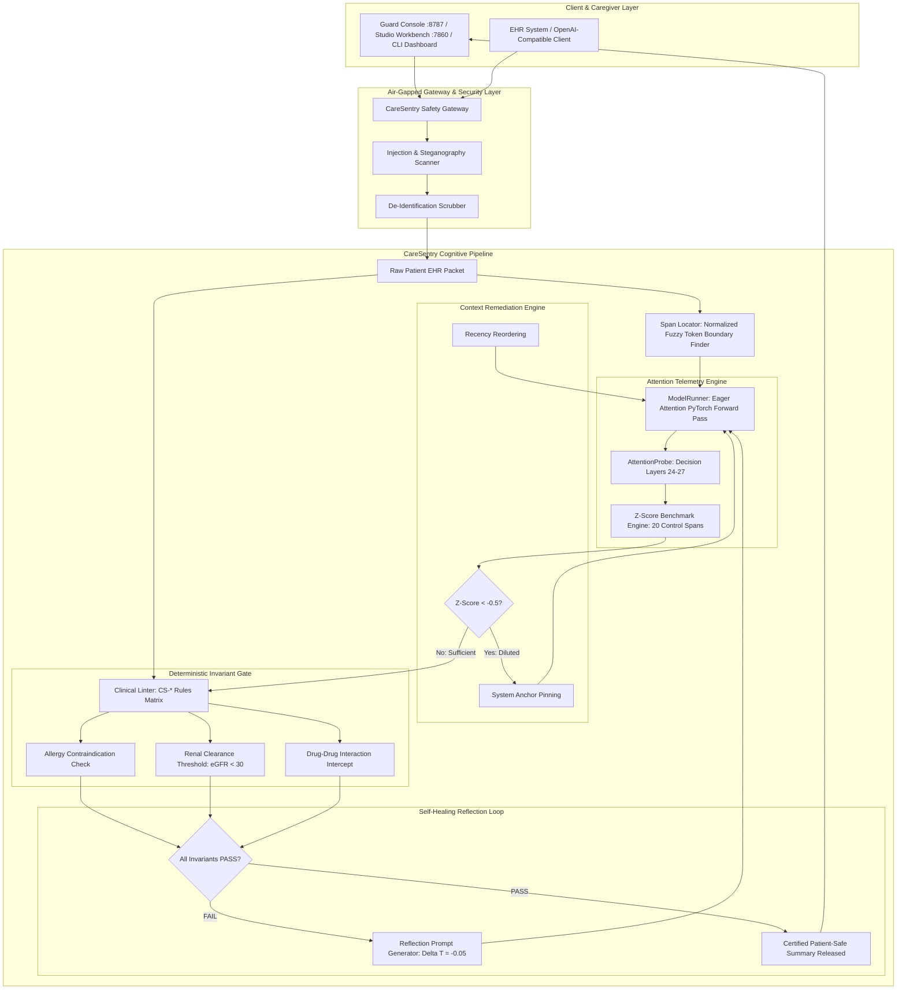

# CareSentry-AI System Architecture

## 1. Executive Summary

**CareSentry-AI** is a dual-layer cognitive sentry and deterministic verification harness engineered for open-weight clinical language models (e.g., Qwen 2.5 1.5B/7B, Gemma 2 2B/9B). When processing lengthy geriatric Electronic Health Records (EHRs)—often exceeding 10,000 to 24,000 tokens—modern transformer architectures suffer from severe attention dispersion known as the **"Lost-in-the-Middle"** phenomenon. Critical negative constraints (e.g., severe anaphylactic penicillin allergies, eGFR $< 30\text{ mL/min}$ contraindicating Metformin) buried at 40%–60% document depth receive negligible attention weights, causing generative models to order lethal medications.

CareSentry-AI solves this through an air-gapped, zero-cloud architecture combining:
1. **Empirical Attention Probing**: Direct tensor slicing into model decision layers to quantify constraint attention using empirical Z-score statistical benchmarking.
2. **Context Remediation Engine**: Automated prompt rewriting (System Anchor Pinning & Recency Reordering) when attention dilution ($Z < -0.5$) is detected.
3. **Deterministic Clinical Invariant Gate**: A sub-10ms rule engine conforming to `agent-skills.io/v1` that intercepts contraindications regardless of model attention score.
4. **Self-Healing Reflection Loop**: Automated iterative re-prompting with stepped temperature cooling ($\Delta T = -0.05$).

---

## 2. Architectural Blueprint

---

## 3. Subsystem Breakdown

### 3.1 Model Runner & Tensor Extractor (`harness/model_runner.py`)
- **Eager PyTorch Execution**: Bypasses fused kernel optimizations via `attn_implementation="eager"` to materialize all 4D attention tensors $[\text{batch}, \text{heads}, \text{seq\_len}, \text{seq\_len}]$.
- **Device Placement**: Automatically binds to NVIDIA CUDA (`cuda`), Apple Silicon Metal (`mps`), or CPU with FP16/FP32/4-bit NF4 precisions.
- **Air-Gapped Guarantee**: Strictly executes local Hugging Face checkpoints without network egress or API keys.
- **Mathematical Simulation Fallback**: Provides lazy-evaluated dispersion modeling for lightweight testing and air-gapped CI environments.

### 3.2 Attention Probe & Z-Score Engine (`harness/attention_probe.py`)
- **Decision Layer Isolation**: Probes the final 4 transformer layers where semantic reasoning and factual commitment occur.
- **Control Span Normalization**: Selects 20 non-overlapping token spans of identical length across the document background.
- **Statistical Metric**:
  $$Z = \frac{\bar{A}_{\text{target}} - \mu_{\text{controls}}}{\sigma_{\text{controls}} + 10^{-9}}$$
- **Categorization**:
  - $Z \ge +1.0 \implies$ `SUFFICIENTLY_ATTENDED`
  - $-0.5 \le Z < +1.0 \implies$ `NEUTRAL`
  - $Z < -0.5 \implies$ `DILUTED`

### 3.3 Span Locator (`harness/span_locator.py`)
- **Robust Substring & Token Indexing**: Maps raw clinical characters to exact BPE/SentencePiece token intervals $[k_{\text{start}}, k_{\text{end}})$.
- **Fuzzy Normalization**: Resolves differences in whitespace, punctuation, and subword boundary splits between patient EHR text and tokenizer encodings.

### 3.4 Context Remediation Engine (`harness/mitigations.py`)
- **System Anchor Pinning**: Extracts the diluted clinical needle and pins it into terminal instruction prompts.
- **Recency Reordering**: Relocates critical middle-depth sentences into the final 10% recency zone where attention is naturally heightened by recency bias.
- **Combined Remediation**: Applies multi-tiered mitigation to restore $Z$-scores from negative dilution ($Z \approx -2.5$) to strong anchoring ($Z \ge +2.0$).

### 3.5 Deterministic Clinical Invariant Gate (`harness/clinical_linter.py`)
- **Formal Invariant Matrix**: Evaluates allergies, renal cutoffs, and drug-drug interactions with stable `CS-*` identifiers.
- **Zero Suppression Principle**: Completely decoupled from model attention; even if an attention score is artificially high, any invariant violation immediately causes a hard `FAIL`.
- **Character-Span Offsets**: Pinpoints exact start/end offsets in summary text and source EHR for visual UI highlighting.
- **Serial Lab Extraction**: Discovers chronological renal labs (BUN, Serum Creatinine, eGFR) and selects the most recent discharge measurements.

### 3.6 Multi-Cycle Self-Healing Loop (`harness/self_healer.py`)
- **Automated Interception**: Halts unsafe model outputs before caregiver delivery.
- **Reflection Directives**: Synthesizes specific corrective instructions targeting offending drugs.
- **Temperature Stepping**: Drops decoding temperature by $0.05$ per attempt (Cycle 0: $T=0.70$, Cycle 1: $T=0.65$, Cycle 2: $T=0.60$) to minimize stochastic hallucinations.

---

## 4. Standard Data Contracts

CareSentry-AI uses versioned, schema-validated JSON contracts in `contracts/`:

| Contract Schema | Description | Key Fields |
| :--- | :--- | :--- |
| `attention_trace.v1.schema.json` | Live attention tensor telemetry payload | `model_id`, `layers_used`, `needle_span`, `z_score`, `classification`, `mitigation_applied` |
| `audit_result.v1.schema.json` | Deterministic invariant audit report | `status`, `total_violations`, `violations`, `renal_metrics`, `execution_time_ms`, `standard` |
| `mitigation_strategy.v1.md` | Formal specification for context remediation | `strategy_id`, `input_doc`, `needle`, `remediation_type`, `expected_z_delta` |

---

## 5. Security & Isolation Model

- **Local Process Execution**: Every pipeline stage runs in-process or via local loopback (`127.0.0.1`).
- **Cryptographic Hash Chaining**: Clinical audit events produce deterministic SHA-256 block hashes for verifiable audit logging.
- **No PHI Egress**: All patient records and attention arrays remain in volatile local RAM.
