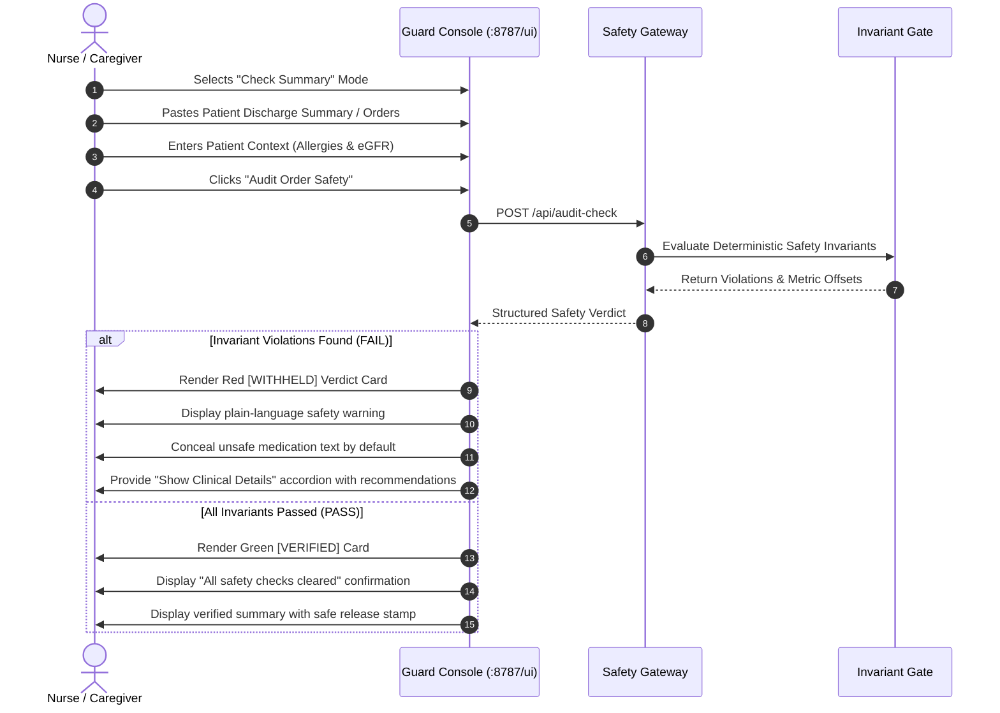
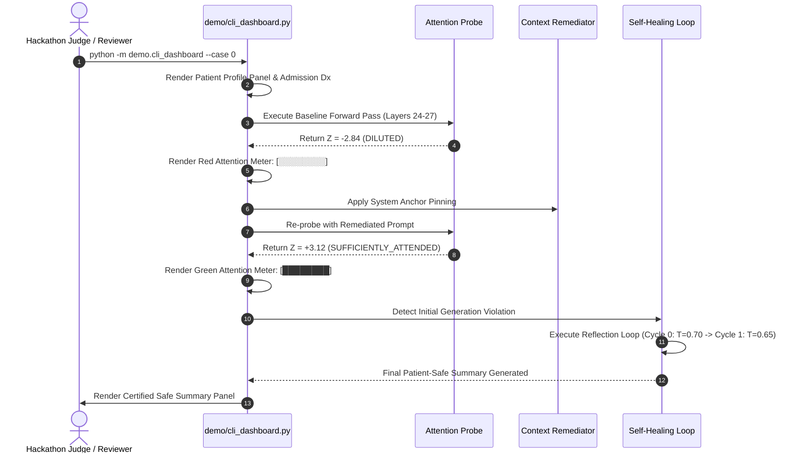

# CareSentry-AI UI/UX Interaction Flow Specification

## 1. User Personas & Design Philosophy

CareSentry-AI provides specialized user interfaces tailored to three distinct user groups:

1. **Caregivers & Bedside Nurses**: Non-technical healthcare providers using the **Guard Console** (`http://127.0.0.1:8787/ui`) to ask questions or verify discharge orders with zero complex technical jargon.
2. **Clinical Safety Officers & Auditors**: Hospital quality-assurance personnel reviewing flagged invariant clashes, character-span evidence, and cryptographic audit trails.
3. **AI Researchers & Safety Engineers**: Machine learning developers investigating live attention heatmaps, decision-layer Z-scores, and token-level mitigation strategies via the **Studio Workbench** (`http://127.0.0.1:7860`) or **Rich Terminal Dashboard** (`demo/cli_dashboard.py`).

---

## 2. Interface Surfaces

```
┌─────────────────────────────────────────────────────────────────────────────┐
│                             CareSentry-AI Surfaces                          │
├──────────────────────────┬──────────────────────────┬───────────────────────┤
│ 1. Guard Console         │ 2. Terminal Dashboard    │ 3. Studio Workbench   │
│ URL: 127.0.0.1:8787/ui   │ Command: demo.cli_dash   │ URL: 127.0.0.1:7860   │
│ Audience: Nurse/Caregiver│ Audience: Live Demos     │ Audience: ML Auditor  │
│ Focus: Plain-Language    │ Focus: Attention Meter   │ Focus: Heatmaps &     │
│        Verdicts & Safety │        & Self-Healing    │        Token Analysis │
└──────────────────────────┴──────────────────────────┴───────────────────────┘
```

---

## 3. Core User Flows

### 3.1 Flow A: "Check Discharge Summary" (Guard Console)



### 3.2 Flow B: Live Attention Probe & Prompt Mitigation (Terminal Dashboard)



---

## 4. Design Tokens & Visual Hierarchy

| Verdict Status | Primary Color | Hex Code | Icon | User-Facing Action |
| :--- | :--- | :--- | :--- | :--- |
| **VERIFIED / PASS** | Emerald Green | `#10B981` | `✅` | Safe to release; orders confirmed non-contraindicated. |
| **WITHHELD / FAIL** | Crimson Red | `#EF4444` | `❌` | Delivery blocked; unsafe orders withheld; clinician consultation required. |
| **NEUTRAL / CAUTION** | Amber Yellow | `#F59E0B` | `⚠️` | Attention ambiguous; manual verification advised. |

### 4.1 Plain Language Directives
In patient-facing surfaces, technical phrases are translated into clear clinical directives:
- `"ALLERGY_CONTRAINDICATION"` $\to$ **"Prescription conflicts with documented allergy"**
- `"RENAL_THRESHOLD_VIOLATION"` $\to$ **"Dose exceeds safe limits for patient's kidney function"**
- `"Z_SCORE_DILUTED"` $\to$ **"Model lost track of critical safety instruction"**
